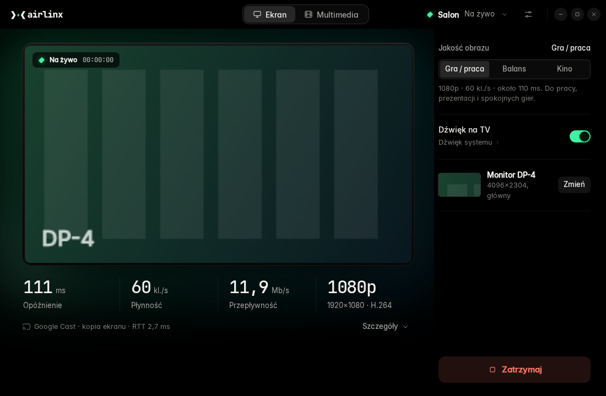

# AirLinx

AirLinx sends a Linux desktop to a TV on the home network. It mirrors a monitor or a single window, with sound, over Google Cast, and plays video, music and photos from disk through the TV's built-in Cast or DLNA receiver. Nothing is installed on the TV.



The app's interface is in Polish. Project page (in Polish): https://tymonpawelczyk.github.io/AirLinx/

## Features

- **Screen mirroring over Google Cast.** A whole monitor or one window, with the mouse cursor and system sound, using the TV's Cast mirroring receiver (AES-128 encrypted). On a Samsung S85F with the "Gra / praca" profile we measured 1080p at 60 fps, 12 Mb/s and about 111 ms from screen to TV, of which about 90 ms is spent inside the TV.
- **Live stats.** Latency, frame rate, bitrate, resolution and network RTT, refreshed twice a second, plus a per-stage latency breakdown (capture, encoder, network, TV). A dropped connection is retried three times (after 1, 2 and 4 s).
- **TV identity check.** Before streaming, AirLinx asks the TV to sign a challenge with its Cast device certificate and checks that the chain ends at the Google Cast root CA. The TV's identity is pinned on first use in `~/.config/airlinx/known_tvs.json`. If it changes later, AirLinx stops and asks whether to trust the TV again.
- **DLNA fallback.** If Cast mirroring is unavailable, AirLinx streams MPEG-TS to the TV's DLNA renderer instead, with noticeably higher latency. A TV whose Cast identity is pinned is never moved to DLNA silently: AirLinx asks first.
- **Media files.** Drop files on the window or add a URL. ffprobe decides per file whether the TV gets it unchanged, remuxed on the fly (for example MKV to fragmented MP4 for Cast) or transcoded. Text subtitles (SRT, ASS, WebVTT) work from a file next to the video or from MKV tracks. Queue, pause, seek and TV volume are in the window. Before a file is handed to a Cast receiver, the TV's identity is verified the same way as for mirroring.
- **Audio source.** System output, a microphone, both mixed, or a single application, sent as Opus 128 kb/s. Audio routing is restored when streaming stops, and on the next start after a crash.
- **Quality profiles.** "Gra / praca" (1080p, 60 fps, 12 Mb/s), "Balans" (1440p, 60 fps) and "Kino" (4K, 30 fps). Switching restarts only the encoder (240 ms measured) and keeps the session. Bitrate can be set by hand from 6 to 40 Mb/s.
- **Encoders.** NVIDIA NVENC when available, libx264 on the CPU otherwise. The settings screen shows which one is in use.
- **Tray and autostart.** Closing the window hides AirLinx to the tray and mirroring continues. "Zakończ" (Quit) stops the stream on the TV before exiting. It can start with the session, hidden in the tray.
- **Busy TV.** If something is already playing on the TV, AirLinx asks before interrupting it.

## Requirements

- Linux with GNOME in an **Xorg (X11)** session. Tested on Zorin OS 17.3 (Ubuntu 22.04 base). Wayland is not supported, and AirLinx shows a warning in a Wayland session.
- System Python 3 (tested: 3.10) with PyGObject, GTK 3 and WebKit2GTK 4.1: `python3-gi`, `gir1.2-gtk-3.0`, `gir1.2-webkit2-4.1`.
- `ffmpeg`, PipeWire or PulseAudio with `pactl`, and the X11 tools `xrandr` and `xprop`.
- AppIndicator / StatusNotifierItem support in GNOME for the tray icon (on by default in Zorin OS and Ubuntu).
- Optional: an NVIDIA GPU with NVENC (tested: RTX 3080). Without it AirLinx encodes with libx264 on the CPU. CPU load and latency for that path have not been measured.
- A TV with Google Cast (mirroring and media) or a DLNA MediaRenderer (media, and mirroring with higher latency) on the same LAN. **Tested only on a Samsung S85F.**
- A firewall that lets through device discovery (mDNS on UDP 5353, SSDP on UDP 1900) and connections from the TV to the PC, because the TV fetches files from AirLinx.

## Installation

```bash
sudo apt install git ffmpeg python3-gi python3-venv gir1.2-gtk-3.0 gir1.2-webkit2-4.1 \
  x11-xserver-utils x11-utils pulseaudio-utils
git clone https://github.com/TymonPawelczyk/AirLinx
cd AirLinx
./install.sh               # add --autostart to start hidden in the tray after login
```

`install.sh` needs no sudo. It copies the app to `~/.local/share/airlinx`, creates its own virtual environment there (with `--system-site-packages`, so it uses the system PyGObject), installs the Python dependencies from PyPI, and adds `~/.local/bin/airlinx`, a menu entry and icons. The installed copy does not depend on the cloned directory. Installation needs internet access for PyPI.

To uninstall:

```bash
./install.sh --uninstall   # settings in ~/.config/airlinx are kept
```

## Usage

```bash
airlinx              # window and tray icon
airlinx --no-window  # start hidden in the tray
airlinx --debug      # DEBUG logs and the WebKit inspector
airlinx --version
```

Or start "AirLinx" from the application menu. Pick a TV (or add one by IP), choose a monitor or window, and press "Udostępnij ekran". On the first connection the TV may ask for permission on its remote. Starting AirLinx a second time raises the existing window.

Settings are stored in `~/.config/airlinx/config.json`. A corrupt file is moved to `config.json.bak` and defaults are used.

## Known limitations

- X11 only. Screen capture uses `x11grab`, `xrandr` and `xprop`.
- The "Balans" and "Kino" profiles are experimental and their latency has not been measured. "Kino" asks the TV for a buffer of at least 400 ms, so its latency is much higher.
- Only one TV has been tested (Samsung S85F). Other Cast devices and DLNA renderers may behave differently.
- DLNA mirroring and all file playback use plain HTTP in the LAN, protected only by a random token in the URL. Only Cast mirroring is encrypted. Use AirLinx on a network you trust.
- Window sharing captures the window's screen area, so anything covering the window is sent too.
- Image-based subtitles (PGS, DVB) are not supported. Subtitles over DLNA are best effort.
- AirPlay and Miracast are not supported. There is no VAAPI encoder, so AMD and Intel GPUs use libx264.

## Privacy

AirLinx has no telemetry, no accounts and no update checks, and the author runs no server it could talk to. It reaches the internet only when you queue a file by URL, and `install.sh` downloads packages from PyPI; the TV itself may contact Google when its Cast receiver starts. Details are in the [privacy policy](docs/legal/POLITYKA-PRYWATNOSCI.md) (Polish).

## Development

```bash
uv venv --python /usr/bin/python3 --system-site-packages .venv
uv pip install --python .venv/bin/python -r requirements-dev.txt
.venv/bin/python -m airlinx --debug
.venv/bin/python -m pytest -q              # offline suite, no TV needed
```

- Test layers (unit, UI and landing e2e with Playwright, `install.sh`, live TV), markers and CI: [docs/TESTING.md](docs/TESTING.md).
- The UI also runs in a normal browser against a mock backend: open `ui/index.html` (`?mock=nodevices|busy|slow`).
- Module contract (Polish): [docs/ARCHITECTURE.md](docs/ARCHITECTURE.md).
- Branching (Git Flow), commit messages and the rules for testing on a real TV: [CONTRIBUTING.md](CONTRIBUTING.md).
- Reporting a vulnerability: [SECURITY.md](SECURITY.md). Bugs and questions: [GitHub Issues](https://github.com/TymonPawelczyk/AirLinx/issues).

## License

Copyright (C) 2026 TymonPawelczyk

AirLinx is free software, licensed under the GNU General Public License, version 3 or (at your option) any later version (`GPL-3.0-or-later`); see [LICENSE](LICENSE). Third-party components and their licenses are listed in [THIRD_PARTY_NOTICES.md](THIRD_PARTY_NOTICES.md). Google Cast, Samsung, DLNA and other product names are trademarks of their owners, and AirLinx is not affiliated with them (see [docs/legal/TRADEMARKS.md](docs/legal/TRADEMARKS.md)).
